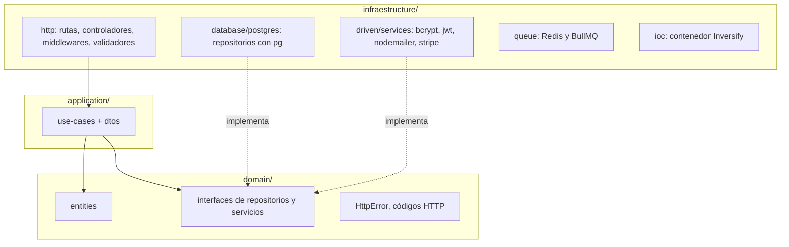
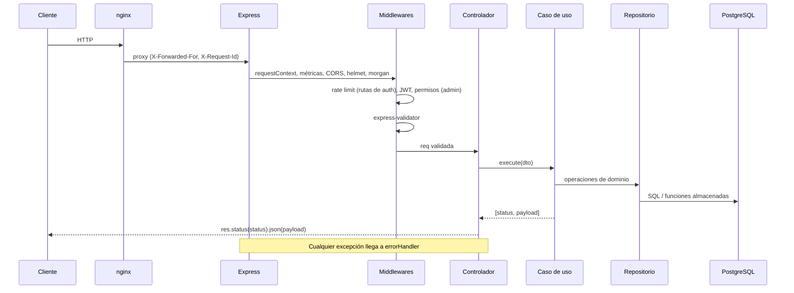
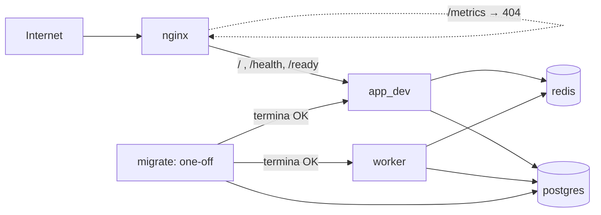

# 1. Arquitectura

## 1.1 Capas (Clean Architecture)

El código vive en `src/` y las dependencias apuntan siempre hacia adentro: `infraestructure → application → domain`. (El nombre de la carpeta es `infraestructure`, con esa ortografía.)

| Capa | Qué contiene | Reglas |
| --- | --- | --- |
| `domain/` | Entidades (`Cart`, `Order`, `Client`...), **interfaces** de repositorios (`ICartRepository`...) y servicios (`IStripeService`, `IMailService`, `IHashingService`), `HttpError`, `HttpStatusCode` | No importa nada de frameworks ni de infraestructura |
| `application/` | Un archivo de casos de uso por funcionalidad (`cart.use-case.ts`...), DTOs, `IJwtService` | Orquesta el dominio. Cada caso de uso es una clase con `execute(dto)` |
| `infraestructure/` | Express, `pg`, Stripe, nodemailer, Redis, winston, configuración, IoC | Implementa las interfaces; es la única capa que conoce librerías externas |
| `main/` | `app.ts` (ensambla Express), `server.ts` (API), `worker.ts` (proceso en segundo plano) | Puntos de entrada |
| `cron/` | Trabajos programados (`products.ts`) | Solo los ejecuta el worker |

> Nota: algunos casos de uso importan `Pool` de `pg` y `INFRASTRUCTURE_TYPES` para manejar transacciones, y `logger` de infraestructura. Es un compromiso pragmático del proyecto: la regla de dependencias se respeta en repositorios y servicios, pero no es pura en el manejo de transacciones.

## 1.2 Inyección de dependencias

`infraestructure/ioc/config.ts` es el **único** lugar donde se cablea todo con [Inversify](https://inversify.io):

- Las interfaces se enlazan a su implementación mediante símbolos definidos en `domain/ioc.types.ts`, `application/ioc.types.ts` y `infraestructure/ioc/types.ts` (ej. `IAuthRepository → PostgresAuthRepository`).
- Casos de uso y controladores se enlazan con `.toSelf()`.
- `IMailService` se enlaza a `QueuedMailService` si hay `REDIS_URL`, y a `NodeMailerService` (envío directo) si no.
- El `Pool` de Postgres es una constante compartida (`INFRASTRUCTURE_TYPES.PostgresPool`).

Para añadir una funcionalidad: crear la interfaz en `domain/repositories`, su implementación en `database/postgres/repositories`, el caso de uso, el controlador, la ruta y **registrar todo en `ioc/config.ts`**. Si olvidas el binding, Inversify falla al resolver el controlador al importar las rutas.

Los archivos de rutas hacen `container.get(Controlador)` al importarse; los middlewares también resuelven servicios del contenedor (por ejemplo `IJwtService`).

## 1.3 Ciclo de una petición

Orden de middlewares globales en `main/app.ts`: `requestContext` → métricas → CORS → `urlencoded` → morgan → helmet (CSP con Stripe en lista blanca) → rutas. El webhook de Stripe se monta **antes** de `express.json()` porque necesita el cuerpo crudo.

**Convención de casos de uso:** devuelven una tupla `[statusHttp, payload]` y el controlador la serializa. Los errores se lanzan como `HttpError(status, mensaje)`; Express 5 reenvía las promesas rechazadas al `errorHandler`, que responde `{ error }` con el código del `HttpError` o `500 { error, requestId }` (registrando el error con winston) para cualquier otra excepción.

## 1.4 Dos procesos, una imagen

La misma imagen Docker ejecuta dos procesos distintos:

| Proceso | Comando | Responsabilidad |
| --- | --- | --- |
| API | `node dist/main/server.js` (por defecto) | HTTP, apagado ordenado con SIGTERM/SIGINT |
| Worker | `node dist/main/worker.js` | Cron de catálogo, caducidad de reservas de órdenes y consumidor de la cola de correos |

Separarlos permite escalar la API sin duplicar tareas programadas. Aun así, cada trabajo programado usa un *advisory lock* de Postgres (`pg_try_advisory_lock`, ver `cron/advisory-lock.ts`), de modo que si hay varias réplicas del worker solo una lo ejecuta.

## 1.5 Topología de despliegue (Docker Compose)

- `migrate` ejecuta `node scripts/migrate.js up` y debe terminar bien antes de que arranquen la API y el worker.
- `db` y `redis` tienen *healthcheck*; la API y el worker esperan a que estén sanos.
- nginx sirve `public/` (CSS/JS) directamente y hace proxy del resto. Añade cabeceras de seguridad, reenvía la IP real y un `X-Request-Id`, y oculta `/metrics`.
- Cada servicio de Compose lee su configuración de `dev.env` (no versionado).
