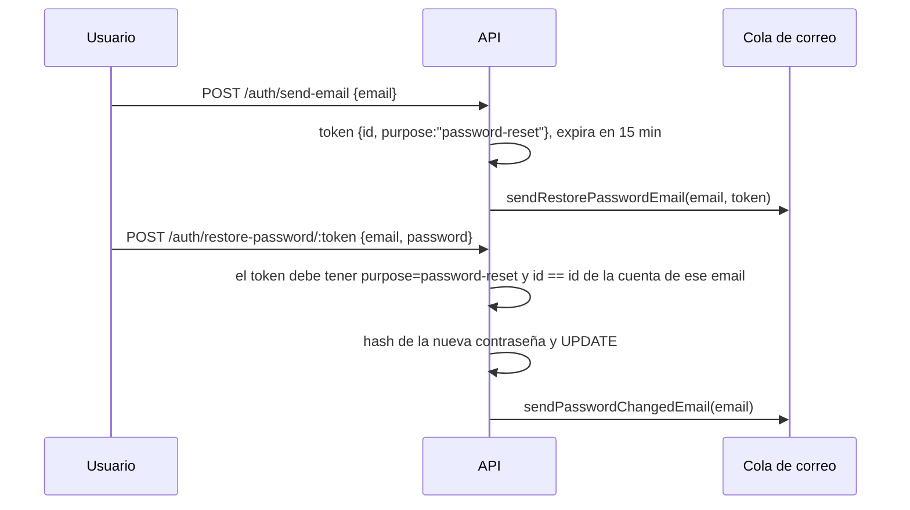
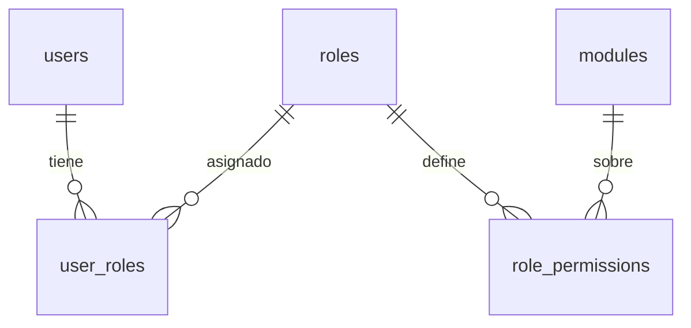
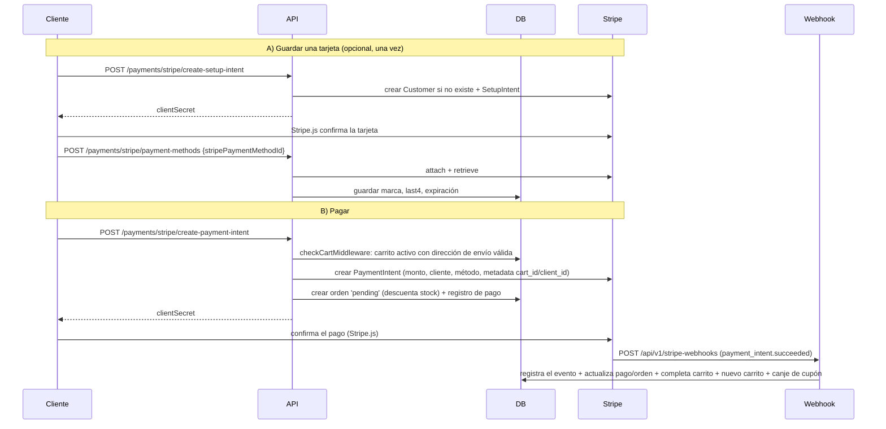
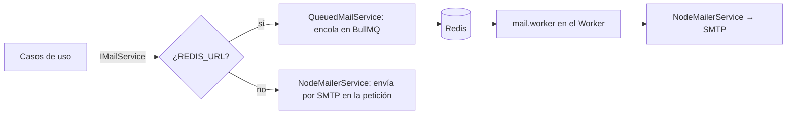

# 2. Flujos principales

## 2.1 Autenticación (dos sistemas separados)

Existen dos poblaciones de usuarios con **secretos JWT distintos** (`JWT_SECRET_CLIENT` y `JWT_SECRET_ADMIN`): clientes de la tienda y administradores del panel. Un token de un sistema no es válido en el otro. El tipo se modela como `ServiceType = 'client' | 'admin'`.

| | Clientes | Administradores |
| --- | --- | --- |
| Tablas | `clients` + `client_passwords` | `users` + `passwords` + `user_roles` |
| Prefijo | `/api/v1/client/auth/*` | `/api/v1/admin/auth/*` |
| Registro público | Sí (`/register`) | No (los crea otro admin vía `/admin/users`) |
| Payload del JWT | `{ id }` | `{ id, roles: number[] }` |
| Duración | 1 hora | 1 hora |

```mermaid
sequenceDiagram
    participant U as Usuario
    participant API
    participant DB
    U->>API: POST /login {email, password}
    API->>DB: BEGIN; buscar usuario por email
    API->>API: bcrypt.compare
    API->>DB: crear carrito si no existe (clientes); actualizar last_access; COMMIT
    API-->>U: 200 {user, token}
    U->>API: GET /recurso  Authorization: Bearer token
    API->>API: validateToken(token, tipo) → req.user
```

- Las contraseñas se guardan con bcrypt (hash de 60 caracteres) en tablas separadas de los datos del usuario.
- El `LoginUseCase` abre una transacción porque, al iniciar sesión, un cliente recibe un carrito activo si no tenía uno (`createCartFromLogin` es idempotente).
- Las rutas de autenticación pasan por `authRateLimiter` (20 peticiones por IP cada 15 minutos).
- `createAuthMiddleware(tipo)` en `auth.middleware.ts` exige `Authorization: Bearer <jwt>`, valida con el secreto del tipo correspondiente y deja el payload en `req.user`. Un token expirado o inválido responde 403.

### Recuperación de contraseña



Reglas de seguridad importantes:
- El token de reseteo **debe pertenecer a la misma cuenta** que el `email` del cuerpo; de lo contrario 403.
- Los tokens con claim `purpose` **nunca** se aceptan como token de acceso (los middlewares de autenticación los rechazan).
- Hoy el token viaja dentro del correo como texto, no como enlace.

## 2.2 Autorización de administradores (RBAC)



- Un **módulo** es un recurso del panel (`users`, `roles`, `products`, `catalogs`, `reviews`, `coupons`, `orders`, `notifications`).
- Un **rol** tiene, por módulo, cuatro banderas: `can_read`, `can_write`, `can_update`, `can_delete`.
- Un usuario puede tener **varios roles**; el acceso se concede si **al menos uno** de ellos tiene el permiso necesario.

`permissionsMiddleware` (montado en `/api/v1/admin` tras `adminAuthMiddleware`) hace lo siguiente:

1. Toma `req.user.roles` del JWT (si no hay roles, 401).
2. Deduce el módulo del **primer segmento de la URL**: `/api/v1/admin/roles/3` → módulo `roles`.
3. Traduce el método HTTP: `GET→can_read`, `POST→can_write`, `PUT/PATCH→can_update`, `DELETE→can_delete`.
4. Busca el módulo en la base de datos (si no existe, 404) y consulta el permiso de cada rol (`getPermissionByRoleAndModule`).
5. Si ningún rol lo tiene, 403.

**Consecuencia práctica:** para añadir una ruta administrativa nueva (`/api/v1/admin/<modulo>`) hay que crear una migración que inserte el módulo en `modules` y los permisos en `role_permissions`; sin eso todas las peticiones a esa ruta responden 404.

Los roles viajan dentro del JWT: si cambias los roles de un usuario, el cambio se aplica cuando inicie sesión de nuevo (o expire su token).

## 2.3 Catálogo de productos

- Tablas: `products`, `categories` (con `parent_id` opcional), `product_categories` (N:M).
- Endpoints públicos: búsqueda (`/products/search`), detalle y listado por categoría. La búsqueda usa un índice GIN de texto completo (`to_tsvector('spanish', ...)`).
- **Sincronización automática:** el worker ejecuta `productsJob` cada día a las 00:00 (zona `America/Mexico_City`). Descarga `https://fakestoreapi.com/products`, sanea el texto a ASCII, asigna `stock: 100` a los productos nuevos y llama a la función SQL `upsert_products_with_categories`, que inserta/actualiza productos y crea las categorías que falten. **En productos existentes no se toca el stock** (el stock lo gobiernan los pedidos).
- Para evitar ejecuciones duplicadas entre réplicas del worker se usa `pg_try_advisory_lock(727001)`.

## 2.4 Carrito y cupones

Cada cliente tiene un carrito `active` (tabla `shopping_carts` + `cart_items`). Estados del carrito: `active`, `pending_payment`, `completed`, `abandoned`.

| Acción | Endpoint | Reglas |
| --- | --- | --- |
| Ver carrito | `GET /cart` | Calcula totales al vuelo |
| Agregar producto | `POST /cart/add/:id` `{quantity}` | Verifica que exista y que `stock >= quantity`; guarda el precio unitario del momento |
| Quitar / vaciar | `DELETE /cart/delete/:id`, `DELETE /cart/clear` | |
| Asignar dirección de envío | `POST /cart/address/:id` | Necesaria para poder pagar |
| Aplicar cupón | `POST /cart/coupons/:code` | Ver reglas abajo |
| Quitar cupón | `DELETE /cart/coupons` | |

**Cálculo del total** (entidad `Cart`, no en SQL):

```
subTotal  = Σ cantidad × precio_unitario
taxes     = round(subTotal × 0.16, 2)          // IVA 16 %
discount  = subTotal × valor/100   (porcentaje)  |  valor  (monto fijo)
total     = subTotal + taxes + shipping − discount
shipping  = 40 (valor fijo por defecto de la entidad Cart)
```

**Reglas al aplicar un cupón** (`ApplyCouponToCartUseCase`): el cupón existe, no ha expirado (`valid_until`), no superó `usage_limit` global ni `per_client_limit` del cliente, y el subtotal alcanza `min_order_amount`. Los canjes se registran en `coupon_redemptions` cuando el pago se confirma.

## 2.5 Checkout y pagos con Stripe

Actores: el cliente, la API, Stripe y el webhook. Los importes se envían a Stripe en centavos (`Math.round(total × 100)`).



Nota: en `/payments/stripe`, las rutas `create-payment-intent`, `create-setup-intent` y `POST payment-methods` pasan por `checkCartMiddleware`, que exige un carrito activo con una dirección de envío válida (404 si no hay carrito, 422 si falta la dirección). Listar y borrar tarjetas no lo requiere.

Detalles del paso B (`CreatePaymentIntentUseCase`):
- Si el carrito ya tiene un PaymentIntent pendiente y reutilizable, se devuelve el mismo `clientSecret` (no se crean intents duplicados). Si ya fue exitoso, 409.
- **La orden se crea en este momento**, en estado `pending`, y `createOrder` descuenta el stock con `UPDATE ... SET stock = stock - n WHERE stock >= n`, una operación atómica que impide vender más de lo disponible (si no alcanza, 409).
- Todo ocurre en una transacción; un fallo hace `ROLLBACK`.

### Webhook (`StripeWebhookController`)

1. Verifica la firma con `STRIPE_WEBHOOK_SECRET` sobre el cuerpo crudo (si falta o es inválida, 400).
2. `payment_intent.succeeded` abre una transacción y:
   1. **Idempotencia:** inserta el `event.id` en `payment_provider_events`. Si ya existía, hace `ROLLBACK`, lo registra y responde 200 sin repetir efectos.
   2. Marca el pago y la orden como `succeeded`.
   3. Pasa el carrito a `completed` y crea uno nuevo para el cliente.
   4. Registra el canje del cupón.
   5. `COMMIT`.
3. Cualquier error → `ROLLBACK`, log y respuesta **500** para que Stripe reintente (el evento no quedó registrado, así que el reintento se procesa).
4. `payment_intent.payment_failed` solo se registra en el log (el carrito sigue activo y el cliente puede reintentar). Otros eventos se ignoran con 200.

## 2.6 Correos y cola



- Con Redis, enviar un correo es encolar un trabajo (`restore-password` o `password-changed`). El worker lo entrega con hasta **5 intentos y backoff exponencial** desde 5 s. Si falla, `removeOnFail` conserva los últimos 5000 para inspección.
- El caso de uso no cambia: depende de `IMailService` y el contenedor decide la implementación.
- Encolar tiene un tope de 5 s; si Redis no responde, la petición falla en lugar de colgarse.

## 2.7 Otros módulos

| Módulo | Qué hace | Notas |
| --- | --- | --- |
| Direcciones | CRUD de direcciones del cliente, una por defecto | Borrado lógico (`deleted`) |
| Wishlists | Varias listas por cliente (`UNIQUE(client_id, name)`), agregar/quitar productos | |
| Reseñas | Una por cliente y producto (`UNIQUE`), rating 1–5; el admin puede moderar (`approved`) o borrar | Índices por producto/rating |
| Cupones (admin) | Crear, listar, actualizar | Tipos `percentage` y `fixed_amount` |
| Usuarios, roles y módulos (admin) | CRUD completo y asignación de roles | Protegido por RBAC |
| Vistas EJS | `/checkout` y `/add-card` para probar Stripe.js | Ver limitaciones |
