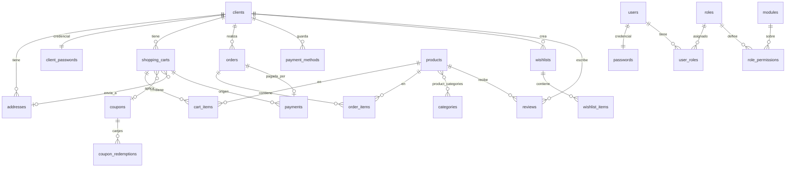

# 4. Base de datos

PostgreSQL 17 (en Compose: `postgres:17-alpine`). Acceso con `pg` y SQL escrito a mano en los repositorios (sin ORM). Una parte de la lógica vive en **funciones almacenadas** invocadas desde los repositorios.

## 4.1 Modelo de datos



### Grupos de tablas

| Grupo | Tablas | Notas |
| --- | --- | --- |
| Clientes | `clients`, `client_passwords`, `addresses` | `clients.external_customer_id` guarda el id del *Customer* de Stripe |
| Administración | `users`, `passwords`, `roles`, `modules`, `role_permissions`, `user_roles` | RBAC; `UNIQUE(role_id, module_id)` |
| Catálogo | `products`, `categories`, `product_categories` | `stock >= 0` por `CHECK`; índice GIN de texto completo en español |
| Compra | `shopping_carts`, `cart_items`, `orders`, `order_items` | `UNIQUE(cart_id, product_id)`; `orders.order_number` único |
| Pagos | `payments`, `payment_methods`, `payment_provider_events` | `UNIQUE(provider, external_payment_id)`; `payments.order_id` único |
| Engagement | `wishlists`, `wishlist_items`, `reviews` | Una reseña por cliente y producto |
| Promociones | `coupons`, `coupon_redemptions` | Tipos `percentage` / `fixed_amount` |

### Estados

| Entidad | Valores |
| --- | --- |
| `shopping_carts.status` | `active`, `pending_payment`, `completed`, `abandoned` |
| `orders.status` | `pending`, `processing`, `shipped`, `delivered`, `cancelled`, `succeeded` |
| `payments.status` | `pending`, `succeeded`, `failed`, `requires_action`, `canceled`, `refunded`, `requires_confirmation` |

### Convenciones

- Casi todas las tablas llevan `created_at`/`updated_at` (`TIMESTAMPTZ`).
- Borrado lógico con la columna `deleted` en clientes, usuarios, roles, módulos, productos, direcciones, wishlists y reseñas.
- Los importes son `DECIMAL(10,2)`; Stripe los recibe en centavos.
- `payment_provider_events (provider, event_id)` es único y sirve para la **idempotencia del webhook**.

## 4.2 Migraciones

Herramienta: [node-pg-migrate](https://github.com/salsita/node-pg-migrate) con archivos SQL en `migrations/` (marcadores `-- Up Migration` / `-- Down Migration`). El script `scripts/migrate.js` construye `DATABASE_URL` a partir de las variables `PSQL_*` (o usa `DATABASE_URL` si existe).

```bash
pnpm migrate up                 # aplica las pendientes
pnpm migrate down 1             # revierte la última
pnpm migrate create nombre --migration-file-language sql
```

| Migración | Contenido |
| --- | --- |
| `…001_initial-schema` | Todas las tablas, índices y restricciones |
| `…002_seed-rbac` | Módulos (`users`, `roles`, `products`, `notifications`), roles `SuperAdmin`/`ProductManager`/`SupportAgent` y sus permisos |
| `…003_stored-procedures` | Funciones de roles/permisos y `upsert_products_with_categories` |
| `…004_fix-product-upsert-keeps-stock` | El *upsert* ya no sobrescribe el stock |
| `…005_payments-payment-method` | Columna `payments.payment_method` que usa el repositorio |
| `…006_seed-missing-admin-modules` | Módulos `catalogs`, `reviews`, `coupons`, `orders` y permisos de `SuperAdmin` |

Reglas de trabajo:
- **Nunca edites una migración aplicada**; añade una nueva. Para cambiar una función almacenada, redefínela con `CREATE OR REPLACE FUNCTION` en una migración nueva.
- Cada migración debe tener un `Down` razonable. El `Down` de la inicial borra todas las tablas excepto `pgmigrations`.
- En Compose, el servicio `migrate` las ejecuta antes de levantar la API y el worker. En otros entornos, ejecútalas como paso previo del despliegue.
- `pgmigrations` registra qué migraciones están aplicadas.

> El primer usuario administrador **no se crea con ninguna migración**: hoy hay que insertarlo manualmente (hash bcrypt en `passwords` y una fila en `user_roles`). Ver [06-limitaciones-y-roadmap.md](06-limitaciones-y-roadmap.md).

## 4.3 Funciones almacenadas

Viven en la migración 003 (y 004 para la redefinición del upsert). Las usan los repositorios de roles y productos:

| Función | Uso |
| --- | --- |
| `create_role`, `update_role`, `delete_role`, `get_roles` | CRUD de roles |
| `assign_permissions_to_role`, `update_role_permissions` | Permisos por módulo |
| `get_permissions_by_role`, `get_permission_by_role_and_module` | Consulta de permisos (esta última alimenta el middleware RBAC) |
| `upsert_products_with_categories(json)` | Sincronización del catálogo: inserta/actualiza productos y crea categorías |

## 4.4 Transacciones y concurrencia

- Las operaciones de varios pasos piden una conexión con `pool.connect()`, ejecutan `BEGIN`/`COMMIT`/`ROLLBACK` y la liberan **siempre** en `finally`. El cliente de la transacción se pasa a los métodos del repositorio como `poolClient`.
- Crear una orden descuenta stock con `UPDATE products SET stock = stock - $1 WHERE id = $2 AND stock >= $1`: es atómico y evita sobreventa sin bloqueos explícitos.
- El webhook inserta el id del evento y aplica sus efectos en **la misma transacción**; la restricción `UNIQUE (provider, event_id)` serializa entregas concurrentes del mismo evento.
- El cron de catálogo usa `pg_try_advisory_lock(727001)` sobre una conexión dedicada para que solo un worker lo ejecute a la vez.
