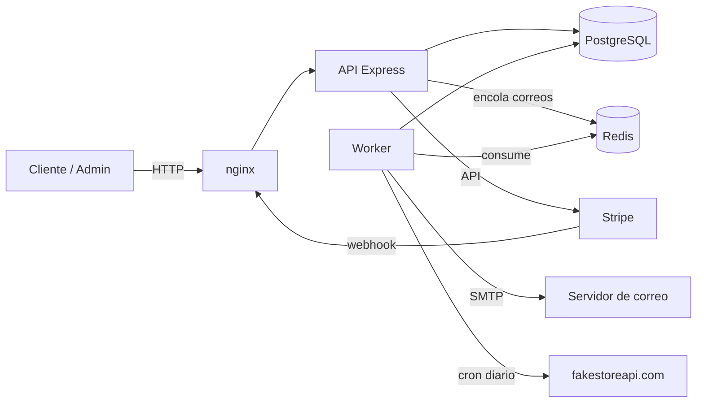

# Documentación técnica

API de e-commerce en Node.js + TypeScript con Clean Architecture. Esta carpeta explica **cómo funciona el proyecto por dentro**; el `README.md` de la raíz cubre la puesta en marcha rápida y `CLAUDE.md` es la guía para agentes de código.

| Documento | Contenido |
| --- | --- |
| [01-arquitectura.md](01-arquitectura.md) | Capas, inyección de dependencias, ciclo de una petición, procesos (API y worker), topología de despliegue |
| [02-flujos.md](02-flujos.md) | Autenticación, RBAC, carrito y cupones, checkout y pagos con Stripe, webhook, correos, cron |
| [03-api.md](03-api.md) | Catálogo de endpoints, convenciones de respuesta y errores |
| [04-base-de-datos.md](04-base-de-datos.md) | Modelo de datos, migraciones, procedimientos almacenados, transacciones |
| [05-operacion.md](05-operacion.md) | Variables de entorno, Docker Compose, probes, logs, métricas, CI, solución de problemas |
| [06-limitaciones-y-roadmap.md](06-limitaciones-y-roadmap.md) | Limitaciones conocidas, deuda técnica y hoja de ruta hacia cloud |

## Mapa mental en 30 segundos

- **API** (`src/main/server.ts`): atiende HTTP. No tiene estado local, se puede replicar.
- **Worker** (`src/main/worker.ts`): sincroniza el catálogo cada noche y envía correos desde la cola.
- **PostgreSQL**: única fuente de verdad. El esquema se versiona con migraciones SQL (`migrations/`).
- **Redis** (opcional): cola de correos y contadores del rate limit compartidos entre réplicas.
